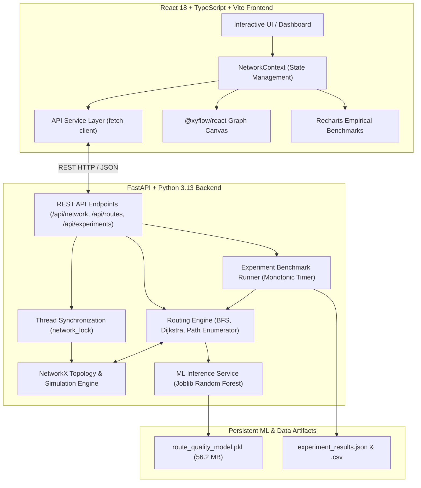
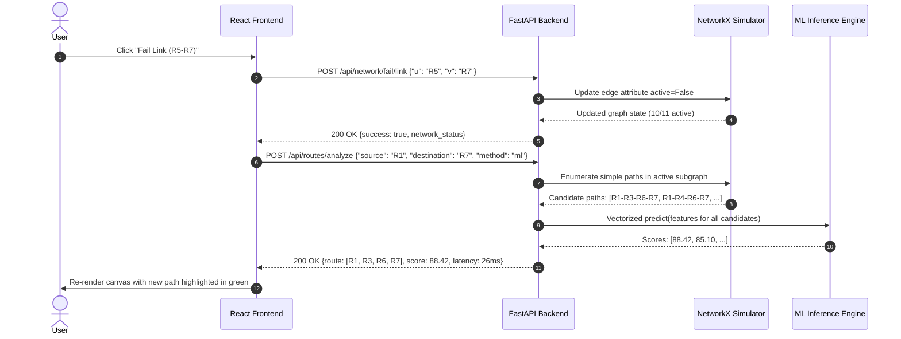
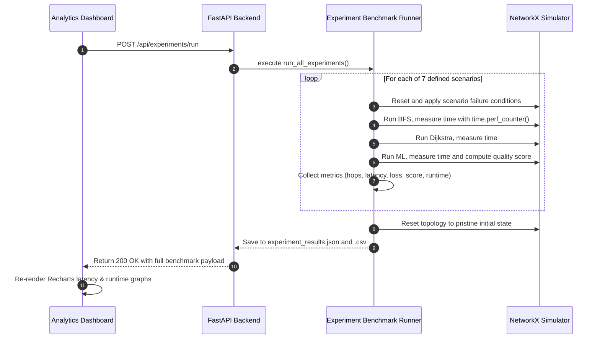

# NetHeal — System Architecture Specification

## 1. System Overview

**NetHeal** is an interactive, AI-powered self-healing network simulator designed to demonstrate autonomous failure detection, dynamic route rerouting, and regression-based route quality evaluation. The system models a 7-router, 11-link carrier-grade topology, evaluates path metrics (latency, bandwidth bottleneck, hop count, and estimated packet loss), and ranks candidate paths using both traditional graph algorithms (BFS, Dijkstra) and a trained Random Forest Regressor.

---

## 2. Component Architecture

### 2.1 Frontend Layer (`netheal-frontend`)
- **Technology Stack**: React 18, TypeScript (strict mode), Vite 5.4, `@xyflow/react` (React Flow 12), Recharts 2.13, Lucide React icons.
- **State Architecture**: `NetworkContext` acts as the single source of truth for UI state, synchronizing graph node/edge statuses with the backend. Mutations (e.g. failing a router or resetting) initiate optimistic requests to FastAPI, updating topology status upon confirmation.
- **Live Connection Monitor**: The topbar features a persistent status indicator that verifies communication with `GET /api/health` and provides a manual reconnect trigger if the server goes offline.
- **View Hierarchy**:
  1. **Overview Dashboard**: High-level network health, active router/link counters, availability percentage, active routing method, and live ML engine status.
  2. **Network Topology**: Interactive pan/zoom canvas displaying routers (R1–R7) and links with status-colored styling and highlighted active route edges.
  3. **Failure Simulator**: Point-and-click failure injection and restoration controls for any router or link, paired with timestamped event logging.
  4. **Route Analysis**: Side-by-side comparison of BFS, Dijkstra, and ML-assisted routing with candidate paths, predicted quality scores, latency, and loss metrics.
  5. **Performance Analytics**: Visualized benchmark charts fed directly from empirical experiment suite outputs (`GET /api/experiments/results`).

### 2.2 Backend Layer (`netheal-backend`)
- **Technology Stack**: FastAPI, Uvicorn, Python 3.13, NetworkX 3.4, Scikit-Learn 1.7.2, Pandas, Joblib.
- **Topology Engine**: Represents the 7 routers (`R1` through `R7`) and 11 bidirectional links as a NetworkX graph with realistic latency (1–20 ms), bandwidth (100–1000 Mbps), and packet loss (0.01%–0.5%).
- **Thread Safety**: Protected with a module-level `threading.Lock` (`network_lock`) around mutating operations (fail, restore, reset) to prevent graph corruption in concurrent environments.
- **Preloading & Performance**: The 56 MB Random Forest model is preloaded into memory during the FastAPI lifespan startup phase, avoiding repeated disk I/O and enabling sub-millisecond inference per candidate route.

---

## 3. Data Flow & Sequence Workflows

### 3.1 Failure Simulation & Dynamic Rerouting

### 3.2 Experiment Suite Execution Flow

---

## 4. Network State Model

The simulated network topology consists of:
- **7 Routers**:
  - `R1`: Edge router (Default Source)
  - `R2`, `R3`, `R4`: Core transit routers
  - `R5`, `R6`: Distribution routers
  - `R7`: Edge router (Default Destination)
- **11 Bidirectional Links**:
  - `R1-R2` (1000 Mbps, 5 ms, 0.01% loss)
  - `R1-R3` (1000 Mbps, 7 ms, 0.02% loss)
  - `R1-R4` (100 Mbps, 12 ms, 0.10% loss)
  - `R2-R3` (1000 Mbps, 3 ms, 0.01% loss)
  - `R2-R5` (1000 Mbps, 9 ms, 0.02% loss)
  - `R3-R5` (1000 Mbps, 8 ms, 0.02% loss)
  - `R3-R6` (1000 Mbps, 10 ms, 0.03% loss)
  - `R4-R6` (100 Mbps, 15 ms, 0.20% loss)
  - `R5-R6` (1000 Mbps, 4 ms, 0.01% loss)
  - `R5-R7` (1000 Mbps, 10 ms, 0.02% loss)
  - `R6-R7` (1000 Mbps, 9 ms, 0.02% loss)

---

## 5. Key Design Decisions and Trade-offs

1. **In-Memory NetworkX State vs. Relational Database**:
   - *Decision*: In-memory NetworkX graph wrapped in thread-safe locking.
   - *Rationale*: Network topology calculations (Dijkstra, simple paths) require instant graph traversals. Introducing a database would add unnecessary serialization overhead for a real-time simulator.
2. **Single-Threaded Model Inference (`n_jobs = 1`)**:
   - *Decision*: Set `model.n_jobs = 1` upon unpickling the Random Forest Regressor.
   - *Rationale*: On Windows systems, joblib/scikit-learn defaults to multiprocessing when `n_jobs = -1`. In web server workers and test runners without `__main__` entry guards, this causes worker deadlocks and process hangs. Single-threaded inference completes in < 2ms for all candidate paths.
3. **Preloading Model during Lifespan**:
   - *Decision*: Load `route_quality_model.pkl` once at FastAPI server startup.
   - *Rationale*: Unpickling 56.2 MB on disk takes ~15-20 seconds on Windows. Preloading eliminates request latencies during live routing queries.
